# Статус · rail-publish · BRO v3.0
Обновлено 2026-10-13 23:48 · режим JOIN · волна W1C-NATIVE

▰▰▰▱▱▱▱▱ **3 из 9 · 33 %** · сейчас «Живая панель и стенд» · ход за 🤖 кодер

**Тебе:** ничего — ждём «Готово» от кодера · **Дальше:** 🛑 Макеты через 1 шаг.

```mermaid
flowchart LR
  n0["✅ Бриф 🛑"]:::done
  n1["✅ Разведка PARTIAL"]:::done
  n0 --> n1
  n2["✅ Сборка PARTIAL"]:::done
  n1 --> n2
  n3["▶ Живая панель и стенд"]:::run
  n2 --> n3
  n4["○ Макеты 🛑"]:::todo
  n3 --> n4
  n5["○ Логика"]:::todo
  n4 --> n5
  n6["○ Интерфейс"]:::todo
  n5 --> n6
  n7["○ Регрессия"]:::todo
  n6 --> n7
  n8["○ Релиз 🛑"]:::todo
  n7 --> n8
  classDef done fill:#DCFCE7,stroke:#16A34A,color:#16181D
  classDef run fill:#E0E7FF,stroke:#4F46E5,color:#16181D
  classDef wait fill:#FEF3C7,stroke:#D97706,color:#16181D
  classDef todo fill:#FFFFFF,stroke:#E6E7EB,color:#5B6170
  classDef pause fill:#F3F4F6,stroke:#9CA3AF,color:#5B6170
  classDef frozen fill:#F3F4F6,stroke:#9CA3AF,color:#5B6170
```

| Показатель | Значение |
|---|---|
| 🎯 Принято с первого раза | 0/2 |
| 🙈 Ложные «готово» | 0 |
| ⏱ Последняя волна: работа / ожидание, мин | 70 / 47 |
| 🪙 ≈ptok на принятую задачу | 3156 |
| 🔌 Обращений к GitHub за волну (среднее) | 8.5 |

Волны · 2

| W | verdict | done/tasks | defects | min | GitHub |
|---|---|---|---|---|---|
| W1-RECON | PARTIAL | 6/6 | 5 | 8 | 12 |
| W1B-BASELINE | PARTIAL | 6/6 | 4 | 70 | 5 |

Страница на ПК: `.bro\progress.html` (двойной щелчок).
