# Статус · rail-publish · BRO v3.0
Обновлено 2026-10-13 21:09 · режим JOIN · волна W1-RECON

▰▱▱▱▱▱▱▱ **1 из 7 · 14 %** · сейчас «Разведка» · ход за 🧠 аналитик

**Тебе:** напиши аналитику: BRO CHECK · **Дальше:** 🛑 Макеты через 1 шаг.

```mermaid
flowchart LR
  n0["✅ Бриф 🛑"]:::done
  n1["▶ Разведка"]:::run
  n0 --> n1
  n2["○ Макеты 🛑"]:::todo
  n1 --> n2
  n3["○ Логика"]:::todo
  n2 --> n3
  n4["○ Интерфейс"]:::todo
  n3 --> n4
  n5["○ Регрессия"]:::todo
  n4 --> n5
  n6["○ Релиз 🛑"]:::todo
  n5 --> n6
  classDef done fill:#DCFCE7,stroke:#16A34A,color:#16181D
  classDef run fill:#E0E7FF,stroke:#4F46E5,color:#16181D
  classDef wait fill:#FEF3C7,stroke:#D97706,color:#16181D
  classDef todo fill:#FFFFFF,stroke:#E6E7EB,color:#5B6170
  classDef pause fill:#F3F4F6,stroke:#9CA3AF,color:#5B6170
  classDef frozen fill:#F3F4F6,stroke:#9CA3AF,color:#5B6170
```

| Показатель | Значение |
|---|---|
| 🎯 Принято с первого раза | - |
| 🙈 Ложные «готово» | 0 |
| ⏱ Последняя волна: работа / ожидание, мин | - / - |
| 🪙 ≈ptok на принятую задачу | - |
| 🔌 Обращений к GitHub за волну (среднее) | - |

Волны · 0

| W | verdict | done/tasks | defects | min | GitHub |
|---|---|---|---|---|---|

Страница на ПК: `.bro\progress.html` (двойной щелчок).
