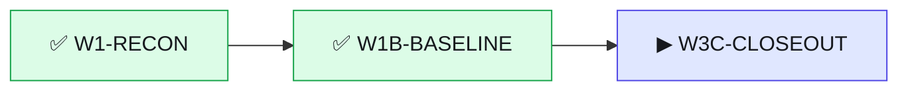

# Статус · rail-publish · BRO v3.0
Обновлено 2026-10-14 23:45 · режим JOIN · волна W3C-CLOSEOUT

▰▰▰▰▰▱▱▱ **2 из 3 · 67 %** · сейчас «W3C-CLOSEOUT» · ход за 🧠 аналитик

**Тебе:** напиши аналитику: BRO CHECK · **Дальше:** остановок больше нет

| Показатель | Значение |
|---|---|
| 🎯 Принято с первого раза | 0/2 |
| 🙈 Ложные «готово» | 0 |
| ⏱ Последняя волна: работа / ожидание, мин | 70 / 47 |
| 🪙 ≈ptok на принятую задачу | 3156 |
| 🔌 Обращений к GitHub за волну (среднее) | 8.5 |

Волны · 2

| W | verdict | done/tasks | defects | min | GitHub |
|---|---|---|---|---|---|
| W1-RECON | PARTIAL | 6/6 | 5 | 8 | 12 |
| W1B-BASELINE | PARTIAL | 6/6 | 4 | 70 | 5 |

Страница на ПК: `.bro\progress.html` (двойной щелчок).
